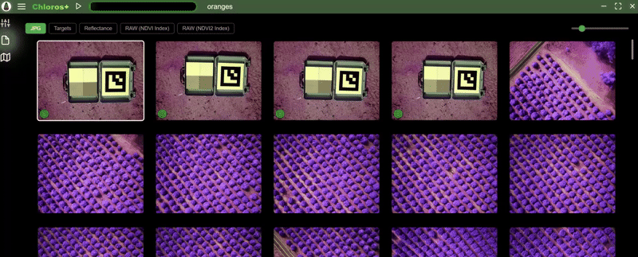

# První kroky

<figure><figcaption></figcaption></figure>

Chloros je softwarová aplikace od společnosti [MAPIR](https://www.mapir.camera) určená ke zpracování multispektrálních snímků, živému ovládání hardwaru MAPIR a záznamu dat ze senzorů. Chloros 1.3.0 podporuje celou produktovou řadu MAPIR:

* **Kamery Survey3** — zpracovávají snímky ve formátu RAW+JPG na kalibrované mapy odrazivosti a vegetačních indexů. Viz [Podporované kamery](supported-cameras.md).
* **Kamery LATTICE** — připojte multispektrální kamerové moduly GigE v reálném čase, jednotlivě nebo jako synchronizovaná pole více kamer: náhled, snímání a zpracování do kalibrovaných produktů zářivosti a odrazivosti. Viz [sekce LATTICE](lattice/README.md).
* **Světelné senzory DAQ** — spektrální senzory DAQ-U (USB), DAQ-M (Bluetooth) a DAQ-E a DAQ-E-S (Ethernet): živá kalibrovaná spektra, `.daq` záznamy a osvětlení směřující dolů pro zpracování odrazivosti. Viz [sekce DAQ](daq/README.md).


**Novinky ve verzi Chloros 1.3.0**: AI asistenti mohou ovládat Chloros prostřednictvím `chloros-mcp` a stejné funkce nabízejí také CLI, SDK a `chloros-mcp`. Produkty s indexem LATTICE byly vylepšeny, pole se všemi senzory jsou rychlejší a fungují v jakékoli síti a backend pokračuje v běhu i mezi jednotlivými příkazy. Podívejte se na seznam novinek níže a [stáhněte si](download.md) instalační soubory.



**Používáte Chloros s AI asistentem?** Tato příručka je pro to určena. Nasměrujte svého asistenta na:

* `https://mapir.gitbook.io/chloros/llms.txt` — strojově čitelný index všech stránek.
* Jakoukoli stránku ve formátu Markdown — připojte k její URL adrese `.md` (např. `https://mapir.gitbook.io/chloros/reference/cli-reference.md`).
* [Referenční příručka pro CLI](reference/cli-reference.md) a [Referenční příručka pro SDK](reference/sdk-reference.md) — kompletní referenční stránky s přesnými hodnotami napsané pro použití s LLM.

Příklad zadání: *„Přečti si https://mapir.gitbook.io/chloros/reference/cli-reference.md, a poté napiš skript, který se přihlásí a zpracuje složku ~/flights/flight_001 do GeoTIFF souborů s odrazivostí a NDVI.“*

Nebo nechte přímo spustit Chloros: `chloros-mcp`, server MCP nainstalovaný spolu s SDK, spolupracuje s aplikacemi Claude Desktop, Claude Code, Cursor a dalšími klienty MCP.

Kompletní průvodce: [Používání Chloros u s AI asistenty](ai-assistants.md).


***

## Co je nového v Chloros u 1.3.0

* **AI asistenti mohou ovládat Chloros.** `chloros-mcp`, server MCP nainstalovaný spolu s Python SDK, umožňuje aplikacím Claude Desktop, Claude Code, Cursor a dalším klientům MCP zpracovávat obrazová data a ovládat kamery LATTICE, pole a světelné senzory DAQ. Viz [Používání Chloros s AI asistenty](ai-assistants.md).
* **CLI, SDK a `chloros-mcp` nabízejí stejné funkce.** Z bezpečnostních důvodů zůstávají v CLI pouze přihlášení, provisioning DAQ-E a přímé servery DAQ. Některé skripty verze 1.2.0 vyžadují úpravy: viz **Změny ve verzi 1.3.0** v horní části [Referenční příručky k CLI](reference/cli-reference.md) a [Referenční příručky k SDK](reference/sdk-reference.md).
* **Vylepšené indexové produkty LATTICE.** NDVI a další indexové produkty exportované ze snímků LATTICE byly vylepšeny ve všech režimech zpracování.
* **Možnosti instalačního programu pro Windows.**V části**Systémová nastavení**nabízí instalační program možnosti**Povolit dlouhé cesty ve Windows**a**Vyloučit backend Chloros ze skenování Microsoft Defender**, přičemž obě jsou ve výchozím nastavení zaškrtnuty. První možnost umožňuje, aby složky projektů měly názvy delší než 260 znaků; druhá zabraňuje tomu, aby skenování v reálném čase zpomalovalo snímání kamerou (přibližně o 30 % při vysokých snímacích frekvencích). Instalační program nyní také přidává složku CLI do `PATH` pouze jednou a odstraňuje duplicitní položky, které zanechaly předchozí instalátory. Viz [Stáhnout](download.md).
* **Příliš hluboké projektové složky jsou předem odmítnuty.** Je-li ve Windows u vypnuta podpora dlouhých cest (výchozí nastavení Windows u), je projektová složka, která překračuje limit 260 znaků pro délku cesty, odmítnuta ještě před spuštěním procesu, přičemž se zobrazí nejdelší projektová složka, která se vejde, a pokyny k zapnutí podpory dlouhých cest. Dříve takový běh nezaznamenal žádné výstupy. Při zapnutých dlouhých cestách si produkty ve velmi hlubokých složkách nyní zachovávají svá metadata (GPS a XMP tagy).
* **Omezovací masky.** Pokud při rozkladu pásem produktu radiance nebo odrazivosti LATTICE vznikne záporná hodnota pásma, je tato hodnota oříznuta na nulu a maska pro jednotlivé pixely ve složce `clamp_masks/` vedle složek s produkty zaznamenává, které pixely a pásma byly ovlivněny. Produkt pojmenovává svou masku v tagu `Chloros:UnmixClampMask`. Živé náhledy nyní ořezávají přesně stejně jako export. Viz [Formáty výstupních obrázků](output-image-formats.md).
* **Produkty se popisují samy.** Indexové produkty nesou vlastní značky zpracování (`Chloros:ProcessingLevel=index`, indexový výraz a informaci, zda byly vypočítány z radiance nebo odrazivosti) namísto značek zdrojového surového souboru. Produkty Survey3 nesou značky zpracování Chloros ve všech režimech zpracování. Surové soubory LATTICE a soubory po odstranění bayerského filtru si zachovávají nativní orientaci snímače a zaznamenávají svou orientaci v XMP; prohlížeč obrázků je otáčí pouze pro účely zobrazení.
* **Balíčky pro Linux se dodávají v rozbaleném stavu.** Backend a CLI se instalují jako složky pod `/usr/lib/chloros/`, takže se již při každém spuštění samy nerozbalují. Na x86_64 již backend netrvá při spuštění asi 100 sekund a velikost souboru `.deb` je přibližně poloviční oproti dřívějšku. Součástí balíčku je nyní ExifTool, který nyní běží na čisté instalaci Ubuntu. `.deb` nyní také instaluje Python SDK pro systém `python3` (nainstalujte jej pomocí `sudo apt install ./chloros_1.3.0_<arch>.deb`), zvětšuje velikost přijímacích bufferů socketů jádra, které potřebují datové toky z kamery, a přidává backendovou službu, která běží pod vaším uživatelským účtem. Balíček pro Jetson, `chloros_1.3.0_arm64_jp6.deb`, je sestaven pro JetPack 6 a zpracovává data na GPU Jetsonu pomocí CUDA verze PyTorchu pro JetPack. V systému Linux se každý exportovaný snímek nyní dostane na disk jednou (zapsán a označen v paměti, poté zkopírován na místo): na Jetsonu, kde tempo určuje disk, trvá běh LATTICE se 288 snímky 14 minut místo 24. Viz [Instalace v systému Linux](linux/linux-installation.md).
* **Kamery LATTICE OCN měří přesněji na slunci.** Radiance, odrazivost a indexy procházejí rychlou korekcí po rozložení spektrálních pásem, takže šedý cíl vykazuje na slunci hodnotu blízkou neutrálnímu NDVI. Kamery RGN zůstávají beze změny.
* **Hlášení chyb přímo v aplikaci.** Ikona chyby v horní části záložky „Debug Log“ odešle do MAPIR u popis, až 10 snímků, protokoly a podrobnosti o systému. Viz [GUI: Navigace](navigation.md).
* **LATTICE pole.**Pole ve výchozím nastavení zachovávají plný rozsah snímače a komprimovaný 12bitový přenos (`--packed`, výchozí `auto`) zvyšuje snímkovou frekvenci při plném rozsahu snímače přibližně o třetinu; pole funguje v jakékoli síti při snímkové frekvenci, kterou síť umožňuje (pomalé připojení sníží snímkovou frekvenci, místo aby pole odmítlo nebo zmenšilo jeho snímky); pole, u kterého došlo k restartu kamer, se samo obnoví a PTP se znovu zapne; automatická expozice již při slabém osvětlení tuto frekvenci nesnižuje (nejprve vyplní dané časové období a poté zvýší zisk); Kontinuální snímání drží krok s rychlými poli; ovládací prvek**Highlights** pro RGB kamery; a SDK získává `ArraySession`, `grab()`, `frame_stream()` a `continuous()`. Viz [sekce LATTICE](lattice/README.md).
* **Stabilnější automatická expozice.** Expozice se při konstantním osvětlení udržuje a po změně se ustálí během několika sekund; drobné světlé oblasti již scénu nezatemňují; při ručním nastavení expozice zůstává zesílení v režimu Auto; a kamera, která přestane reagovat na přímém slunci, se udržuje na úrovni odpovídající danému osvětlení, které je měřeno světelným senzorem nebo, pokud není připojen žádný, vlastními snímky kamery. Viz [Nastavení kamery](lattice/camera-settings.md).
* **Světelné senzory.** **Podpora DAQ-E-S:** její pevný difuzor nevyžaduje korekci krytky a každé měření obsahuje údaje o náklonu, otáčení a sklonu jednotky. Záznam uvádí, zda byl kryt vybrán nebo předpokládán, a při zpracování se zobrazí varování v případě předpokládaného krytu: modely DAQ-U, DAQ-M a DAQ-E se dodávají bez krytu, proto je třeba pojmenovat ten, který je nasazen. Živé záznamy `.daq` přežijí výpadek napájení (uchovejte soubor `.daq-journal` spolu s jeho `.daq`), a DAQ-E, který přestane vysílat data, se znovu připojí s mezerou označenou v jeho záznamu. Projekt, který obsahuje pouze záznamy ze světelných senzorů, je vypisuje a zpracovává z aplikace i z CLI, a záznam pořízený pomocí `chloros_scripts` je uveden jako DAQ, který jej pořídil, s omezením, které můžete nastavit. Každé zachycení ukládá hodnotu DAQ, kterou použilo. Viz [sekce DAQ](daq/README.md).
* **Zpracování.**Snímky LATTICE začínají být zpracovávány během detekce cíle. Referenční hodnoty cíle a DAQ se určují pro každé pásmo. Přesunutý projekt znovu propojí své soubory. Exporty 8bitových snímků jsou v 8bitovém formátu, a to v novém formátu**TIFF (8-bit)**. Snímek z programu Survey3 bez kalibračního cíle se ukládá jako jeho náhradní produkt (`Vignette_Corrected_Images` nebo `Sensor_Response_Images`), nikoli jako odrazivost. DLS tagy odrazivostního snímku pro jednotlivá pásma vždy patří k jeho vlastnímu snímku. Funkce Texture Aware je u snímků LATTICE odmítnuta; u těchto snímků se vždy použije standardní debayer.
* **CLI a SDK.** Relativní výstupní cesty nyní směřují do složky, ze které spouštíte příkaz nebo skript (nainstalovaný backend je dříve řešil ve své vlastní instalační složce, což vedlo k selhání). Backend běží i mezi příkazy a skripty a po 30 minutách nečinnosti se sám zastaví; spravují to `chloros-cli backend status` a `backend stop`. Příkazy pro snímání uvedou seznam všech souborů, do kterých se nepodařilo zapsat, a ukončí se s kódem 1; opakované snímání se zastaví, jakmile je disk plný. Úspěšné spuštění `process` vygeneruje zprávu `Image products written: N (plus M clamp masks)`. Ve Windows u SDK `ChlorosLocal` / `process_folder` vyhledá nainstalovaný backend (a použije ten, který již běží), zatímco `read_image_audit_tags` funguje z prostého `pip install`.

***

## Co je nového v Chloros u 1.2.0

* **Ovládání kamer v reálném čase — nová záložka „Kamery“.** Připojte kamery LATTICE jednotlivě nebo jako synchronizovaná pole více kamer (časová synchronizace PTP, snímání spouštěné hardwarem), s překryvy živého náhledu, histogramy pro jednotlivá pásma, inteligentní automatickou expozicí, kalkulátorem živého indexu a aktualizacemi firmwaru kamer přímo v aplikaci.
* **Světelné senzory — nová záložka „Světelné senzory“.** Připojte senzory DAQ-U (USB), DAQ-M (Bluetooth) a DAQ-E (Ethernet); prohlížejte si živá kalibrovaná spektra (W/m²/nm), ukládejte soubory `.daq` do svého projektu, vybírejte profily korekce kap a aktualizujte firmware DAQ-E přes síť.
* **Režimy snímání a záznamníky.** Jednorázové / nepřetržité / intervalové snímání plus režim „Fastest Capture“ pouze pro surová data; výběr pro každý projekt, které kamery a typy exportu generuje funkce „Capture All“; maticové záznamníky pro indexové video v monitorovací kvalitě a surové série snímků v analytické kvalitě s offline sestavováním videa.
* **Zpracovací pipeline LATTICE.** Importujte složky se záznamy LATTICE a každý surový snímek rozložte na produkty s odstraněným bayesovým kódováním, náhled, radianci float32 (W/m²/sr/nm) a odrazivost s přepínači pro jednotlivé produkty. Reflexe může pocházet z kalibračního cíle v rámci snímku nebo z datového sběru (DAQ) směrem dolů; při exportu se aplikuje zarovnání pole; chybějící tovární kalibrace se automaticky stáhne podle sériového čísla kamery.
* **Projekty si pamatují hardware.** Připojené kamery a světelné senzory se ukládají spolu s projektem (`cameras.json` / `sensors.json`) a při opětovném otevření projektu se znovu připojí s uloženými nastaveními. Viz [GUI: Projekty](projects.md).
* **Vylepšení prohlížeče obrázků.** Zobrazení pixelů/indexu kurzoru se správným škálováním odrazivosti pro každý soubor, histogramy vrstev, posuvník pro seskupování GSD, režimy mřížky „Per Trigger“ / „Per Camera“, zobrazení produktů LATTICE a export indexu/LUT do sandboxu na disk.
* **Výrazně rozšířené rozhraní CLI a SDK.** Nové rodiny příkazů `lattice`, `daq pool-*`, `project` a `time-sync`; nové volby `process` (`--input-level`, přepínače pro jednotlivé produkty, `--reflectance-source`, příznaky zarovnání pole); inteligentní připojovací identifikátory SDK (`connect_camera` / `connect_array` / `connect_daq_sensor`), které automaticky spouštějí backend; Automatizace `open_project()`; balíček SDK je součástí instalačních programů a je publikován na PyPI jako `chloros-sdk`.
* **Transparentní sémantika selhání.** Spuštění `chloros-cli process`, které požadovalo produkty, ale žádný nezapsalo, nyní hlasitě selže a ukončí se s nenulovým stavem; úspěšná spuštění hlásí, kolik obrazových produktů zapsala.
* **Nové uspořádání výstupu.** Produkty se ukládají do složek `<project>/<camera>/<format>/<Product>_Images/` a zachovávají název zdrojového souboru — produkt identifikuje složka, nikoli přípona souboru. Viz [Formáty výstupních snímků](output-image-formats.md).
* **Více vstupů, plánů a jazyků.** Podpora vstupů `.dng`; všech 38 jazyků rozhraní je plně obsazeno; hardwarová omezení pro jednotlivé plány s bezplatným (bez přihlášení) použitím až 4 kamer a 2 světelných senzorů.
* **Spolehlivost.** Funkce „Zastavit zpracování“ se ukončuje korektně s přesným souhrnem běhu, projekty s více kamerami exportují data ze všech kamer a aktualizace instalačního programu již nezpůsobují odhlášení.

***

Aplikace Chloros je k dispozici ve 3 uživatelských rozhraních:

## Chloros: Desktopová aplikace s grafickým uživatelským rozhraním

Samostatné okno se všemi funkcemi, včetně záložek „Kamery“ a „Světelné senzory“ v reálném čase. _Pouze pro Windows._

## [Chloros CLI: Rozhraní příkazového řádku](CLI.md)

Dávkové zpracování z příkazového řádku plus živé příkazy `lattice`, `daq pool-*`, `project` a `time-sync`. Ideální pro automatizaci, skriptování a provoz bez grafického rozhraní. K dispozici na **Windows, Linux amd64 a Linux arm64 (NVIDIA Jetson)**. _Pro přístup k CLI je vyžadována placená úroveň Chloros+._

## [Chloros API: Python SDK](api-python-sdk.md)

Programové rozhraní v jazyce Python pro automatizaci a vlastní pracovní postupy: zpracování celého zpracovatelského řetězce, živé relace s kamerami/polími, relace se senzory DAQ a automatizace uložených projektů. Instaluje se spolu s balíčkem pro desktop/CLI a je také publikováno jako `pip install chloros-sdk`. _Pro přístup k API je vyžadován placený tarif Chloros+._

***

## Podporované platformy

| Platforma | GUI | CLI | Python SDK |
| --- | --- | --- | --- |
| **Windows 10/11 (x64)** | Ano | Ano | Ano |
| **Linux amd64 (x86_64)** | Ne | Ano | Ano |
| **Linux arm64 (NVIDIA Jetson)** | Ne | Ano | Ano |

Pokyny k instalaci pro Linux najdete v části [Linux a Edge Computing](linux/linux-overview.md).

***

## Začínáme ve třech krocích

1. **Instalace** — stáhněte si a spusťte instalační program pro vaši platformu. Viz [Stažení](download.md).
2. **Přihlášení (volitelné pro grafické rozhraní)** — grafické rozhraní zpracovává obrazy zdarma i bez účtu. [Přihlášení do Chloros+](chloros+-login.md) odemkne paralelní zpracování, akceleraci GPU, vyšší limity zařízení a přístup k CLI a SDK.
3. **Vytvořte svůj první projekt** — otevřete Chloros, vytvořte [nový projekt](projects.md), [přidejte své obrázky](processing-images-gui/adding-files-to-a-project.md) a [zahajte zpracování](processing-images-gui/starting-the-processing.md). Chcete-li místo toho ovládat živý hardware, otevřete kartu Kamery nebo Světelné senzory — viz [GUI: Navigace](navigation.md).

***

## Chloros

Ačkoli je Chloros pro většinu úkolů k dispozici zdarma, možná zjistíte, že potřebujete více. Právě v takovém případě se vám může vyplatit placená licence pro Chloros+. S licencí Chloros+ můžete odemknout nové funkce, jako jsou:

* **Vícevláknové zpracování**: výrazně zrychlete zpracování obrazu u rozsáhlejších projektů díky souběžnému zpracování snímků v rámci zpracovatelského řetězce.
* **Akcelerace pomocí GPU (CUDA)**: využijte dnešní možnosti vyšší kapacity paměti GPU k dalšímu zrychlení zpracovatelského řetězce obrazu. Pro dosažení nejlepších výsledků doporučujeme 4 GB nebo více VRAM.
* **Chloros+**[**CLI**](CLI.md) **Přístup**: spouštějte Chloros+ z příkazového řádku, abyste mohli automatizovat a integrovat do svého vlastního softwaru. K dispozici u všech placených tarifů; vynucováno na straně serveru.
* **Chloros+**[**API**](api-python-sdk.md) **Přístup:** spouštějte Chloros+ z Python u pro programové ovládání, což umožňuje hladkou integraci s vašimi výzkumnými procesy, pracovními postupy pro analýzu dat a vlastními aplikacemi. K dispozici ve všech placených tarifech; vynucováno na straně serveru.
* **Vyšší hardwarové limity**: připojte více kamer a světelných senzorů najednou. Bez přihlášení umožňuje grafické uživatelské rozhraní připojit až 4 kamery a 2 světelné senzory DAQ; placené tarify zvyšují oba limity:

| Tarif | Kamery | Světelné senzory DAQ |
| --- | --- | --- |
| Iron (zdarma, bez přihlášení) | 4 | 2 |
| Copper / Bronze | 6 | 3 |
| Silver | 10 | 6 |
| Gold | 20 | 12 |

* **Použití více zařízení**: každá licence Chloros+ umožňuje registraci 2 a více zařízení. K správě registrovaných zařízení použijte svůj účet MAPIR Cloud. Podporu pro další zařízení získáte upgradem licence Chloros+.
* **Pokročilá metoda debayeringu s ohledem na texturu:** vysoce kvalitní debayering s ohledem na hrany v kombinaci s modelem odšumování založeným na AI/ML, který odstraňuje téměř veškerý šum vznikající při debayeringu.
* **Vlastní vzorce multispektrálních indexů:** zadejte vlastní multispektrální indexy do rastrových kalkulátorů Chloros, a to jak pro zpracování, tak pro testovací prostředí pro prohlížení snímků.
* **Linux a edge computing:** spouštějte Chloros na platformách Linux x86_64 a ARM64, včetně NVIDIA Jetson, pro zpracování v terénu a na okraji sítě. Viz [Přehled Linux u](linux/linux-overview.md).

<a href="https://cloud.mapir.camera/pricing" class="button primary" data-icon="envira">Ceny a registrace do služby Chloros+</a>

<figure><figcaption></figcaption></figure>

<figure><figcaption></figcaption></figure>

<figure><figcaption></figcaption></figure>

<figure><figcaption></figcaption></figure>

<figure><figcaption></figcaption></figure>

<figure><figcaption></figcaption></figure>
<!-- SCREENSHOT-UPDATE: cli.JPG shows the 1.1.0 CLI banner. Re-shoot a terminal running `chloros-cli --version` + `chloros-cli status` on the 1.3.0 build so the banner prints "Chloros CLI 1.3.0". -->
